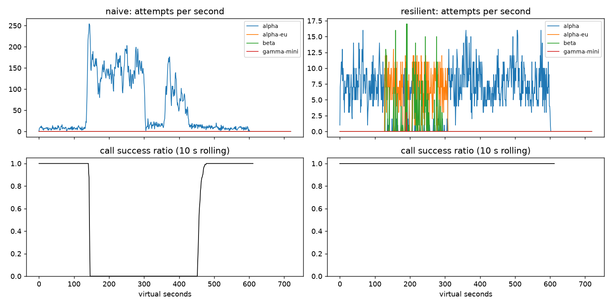

# Lab 25B — Report

**Họ tên / nhóm:** Trần Gia Thành **Mã:** 2A2026026262  **Commit:** 9784424216270ffa796458d4f8bf11a0a36066ea  **Điểm tự động (`make grade`):** 84 / 88 

> Mọi nhận định phải có số. Dán số từ `reports/gameday/*.json`, `reports/workflows.json`, `reports/slo.json`.

## 1. Kết quả Game Day (naive vs của bạn)

| Băng | Client | availability | p95 (s) | amplification | retry_ratio | cost/turn | recovery (s) | PASS? |
|---|---|---:|---:|---:|---:|---:|---:|:---:|
| G1 | naive | 0.7194 | 7.157 | 7.738 | 6.738 | 2.163 | 4 | FAIL |
| G1 | yours | 1.0000 | 4.764 | 1.063 | 0.002 | 2.102 | 0 | PASS |
| G2 | naive | 0.4560 | 15.034 | 9.904 | 8.904 | 4.627 | 155 | FAIL |
| G2 | yours | 1.0000 | 6.776 | 1.041 | 0.008 | 2.129 | 0 | PASS |
| G3 | naive | 1.0000 | 4.768 | 1.164 | 0.164 | 2.328 | 0 | FAIL |
| G3 | yours | 1.0000 | 4.668 | 1.060 | 0.019 | 2.148 | 0 | PASS |
| G4 | naive | 1.0000 | 13.764 | 1.004 | 0.004 | 2.008 | 0 | FAIL |
| G4 | yours | 1.0000 | 5.445 | 1.036 | 0.004 | 2.112 | 0 | PASS |
| G5 | naive | 0.3699 | 5.359 | 17.030 | 16.030 | 2.124 | — | FAIL |
| G5 | yours | 0.8179 | 5.463 | 1.004 | 0.003 | 2.505 | — | PASS |
| G6 | naive | 0.5170 | 4.836 | 12.344 | 11.344 | 2.009 | 0 | FAIL |
| G6 | yours | 0.9979 | 6.067 | 1.055 | 0.016 | 2.221 | 0 | PASS |

`p95` chỉ tính trên lượt thành công, còn `cost/turn` lấy tổng chi phí chia cho số lượt thành công. Vì thế G6 naive có p95 thấp hơn nhưng chỉ phục vụ thành công 51,70% lượt; không thể dùng riêng p95 để kết luận nó tốt hơn.

## 2. Cấu hình client và lý do

| Tham số | Giá trị | Vì sao (dựa trên băng nào, số liệu nào) |
|---|---:|---|
| attempt_timeout_s | 5.0 | G6: tăng lên 30 giây làm availability giảm từ 0.9979 xuống 0.9480 do provider treo giữ request quá lâu. G4 với 5 giây đạt p95 5.445 giây, thấp hơn ngưỡng 10 giây. |
| max_attempts_per_provider | 2 | Chỉ tối đa một retry có budget tại cùng provider. G2 amplification 1.041 thay vì 9.904 của naive; G3 retry_ratio 0.019 thay vì 0.164. |
| backoff_base_s / cap_s | 0.25 / 4.0 | Full jitter phân tán retry. Trong thí nghiệm G2 khi breaker sai và budget bị tắt, retry_ratio lên 0.555 và recovery kéo dài 86 giây; cần vừa giới hạn vừa giãn các retry. |
| retry_budget_ratio | 0.05 | Dành biên dưới ngưỡng retry_ratio 0.10 của G3; thực đo G3 là 0.019. Cùng với `min_per_s=0.1`, `max_tokens=8`, budget vẫn giữ G2 retry_ratio 0.024 khi breaker bị cấu hình sai. |
| breaker.window_size / min_calls | 20 / 10 | Chờ ít nhất 10 kết quả để tránh trip vì vài lỗi lẻ. G2 phục hồi trong 0 giây theo cửa sổ chấm, so với 155 giây của naive; G5 có 0 failover không cần thiết. |
| breaker.failure_rate_threshold | 0.5 | Trip khi ít nhất một nửa kết quả gần đây lỗi; G3 brownout 30% vẫn đạt availability 1.0 và amplification 1.060. |
| breaker.slow_call_s | 4.5 | Xem thành công gần ngưỡng timeout 5 giây là tín hiệu suy giảm. G4 p95 giảm từ 13.764 xuống 5.445 giây. `slow_rate_threshold=0.6` yêu cầu phần lớn kết quả gần đây đều chậm. |
| breaker.open_duration_s | 8.0 | Probe định kỳ sau 8 giây để quay về primary; G2, G4, G6 đều có `primary_share_after_restore` ít nhất 0.8 (G2: 1.0). |
| breaker.half_open_max_probes | 2 | Chỉ hai probe đồng thời, cần hai thành công để đóng breaker. Nhờ đó G2 amplification 1.041 và recovery 0 giây mà không dồn ồ ạt traffic vào provider vừa hồi phục. |

Các giá trị còn lại: `min_time_left_s=1.0` không gửi attempt khi deadline gần hết; `quota_cooldown_s=300` khiến G5 chỉ ghi nhận 2 lỗi quota trước khi chuyển tải khỏi family A; `retry_budget_min_per_s=0.1` và `retry_budget_max_tokens=8` khống chế tốc độ hồi và burst; `breaker.slow_rate_threshold=0.6` và `breaker.half_open_successes=2` tránh chuyển trạng thái vì một quan sát đơn lẻ. Tool call chỉ dùng provider có `supports_tools`, nên G6 có 0 `incompatible_routes`.

Sơ đồ quyết định của `on_error` (loại lỗi → ghi breaker? → retry? → failover? → cooldown?):

```text
CLIENT_ERROR (400)                  → release    → GiveUp, không retry/failover
QUOTA_EXHAUSTED (429)               → release    → cooldown 300 s, failover
RATE_LIMITED (429)                  → release    → cooldown theo retry_after, failover
OVERLOADED / SERVER_ERROR / TIMEOUT → on_failure → còn attempt + budget + deadline?
                                                → có: retry cùng provider với full jitter
                                                → không: failover, bỏ qua breaker OPEN
```

G5 ghi nhận 0 `client_error_retries` và 0 `unneeded_failovers`; G1 có 0 vi phạm `retry_after`.

## 3. Ba thí nghiệm (mỗi cái 3–5 câu + số)

1. **Retry budget là lớp phòng thủ cuối.** Đặt `breaker.min_calls=1000000000`, `max_attempts_per_provider=5`, rồi so sánh budget hiện tại với budget gần như không giới hạn. Trên G2, giữ budget cho amplification 1.369, retry_ratio 0.024, recovery 0 giây và availability 0.9992; tắt budget cho 1.840, 0.555, 86 giây và 0.9543. Trên G3, khi tắt budget, amplification tăng từ 1.123 lên 1.162, retry_ratio tăng từ 0.027 lên 0.158 (vượt ngưỡng 0.10), còn recovery giữ nguyên 0 giây. Breaker hoạt động đúng giúp G2 gốc đạt amplification 1.041, nhưng budget vẫn cần thiết nếu breaker cấu hình sai hoặc chưa đủ mẫu để trip.
2. **`attempt_timeout_s: 30`.** Giữ mọi cấu hình khác, tăng timeout từ 5 lên 30 giây: G6 availability giảm từ 0.9979 xuống 0.9480, dưới ngưỡng 0.95, vì request mắc ở provider treo và hết deadline trước khi failover. G6 p95 của *lượt thành công* đổi từ 6.067 xuống 5.388 giây; chỉ số này che mất các lượt thất bại nên phải đọc cùng availability. Ở G4, p95 tăng nhẹ từ 5.445 lên 5.671 giây và availability vẫn 1.0 do breaker còn phát hiện lời gọi chậm. Timeout nên dựa trên độ trễ bình thường của provider, thời gian cần cho fallback và deadline 30 giây, rồi kiểm tra lại trên băng treo thực tế.
3. **Bỏ lọc tool calling khỏi `ladder()`.** Với G6 và cùng cấu hình, seed client và seed mô phỏng, bản có lọc đạt availability 0.9979, `incompatible_routes=0`; bản bỏ lọc còn 0.8977 và có 244 lượt định tuyến không tương thích. Nói theo sản phẩm: khi các model chính gặp sự cố, 244 lời gọi cần chạy công cụ bị đẩy sang model không biết dùng công cụ, nên khách không thể hoàn thành tác vụ dù model đó vẫn nhận được request. Danh sách fallback phải tôn trọng khả năng của tác vụ, không chỉ độ sẵn sàng của provider.

## 4. Workflow hoàn tiền

| Executor | completion | crashes | duplicate refunds | duplicate emails | lost refunds | overpaid | wasted LLM / crash |
|---|---:|---:|---:|---:|---:|---:|---:|
| naive | 100% (500/500) | 81 | 128 | 81 | 0 | 1,574,200 cents | 1.123 |
| yours | 100% (500/500) | 66 | 0 | 0 | 0 | 0 cents | 0.303 |

Idempotency key ổn định theo `(session, step)` ngăn refund/email bị thực thi lần hai dù response mất hoặc worker chết sau khi tác dụng phụ đã xảy ra. Chỉ có key vẫn phải chạy lại classify, lookup và summary sau crash, làm tăng LLM lãng phí; checkpoint sau mỗi bước thành công giúp worker mới bỏ qua những việc đã xong (bản của tôi có 2.500 checkpoint cho 500 workflow). Chỉ checkpoint mà không có key vẫn có khoảng hở giữa payment thành công và ghi checkpoint: crash trong khoảng đó sẽ hoàn tiền lần hai khi resume. Ghi checkpoint **trước** payment còn nguy hiểm hơn: worker có thể chết trước khi tiền đi nhưng worker sau tưởng đã hoàn tiền, gây mất refund.

## 5. Alerting & error budget

| Sự cố | Mong đợi | Naive alerter | Burn-rate alerter | Độ trễ phát hiện |
|---|---|---|---|---:|
| checkout_bug | page | page (+1 phút) | page | 27 phút |
| provider_outage | page | page (+0 phút) | page | 4 phút |
| deploy_blip | none | page sai | không page | — |
| slow_leak | ticket | không phát hiện | ticket, không page | 1.337 phút |
| degraded_evening | page | page (+214 phút) | page | 291 phút |
| night_spike | none | page sai | không page | — |
| small_bump | none | page sai | không page | — |

Error budget 30 ngày ở SLO 99,5% cho phép 129.508,8 request lỗi trên 25.901.755 request; thực tế có 55.618 lỗi, đã tiêu **42,95%** và còn **57,05%**. `freeze_releases=False`: chưa đóng băng release, nhưng tiếp tục theo dõi burn rate. `small_bump` kéo dài 20 phút ở 12% lỗi: cửa sổ ngắn tăng mạnh nhưng cửa sổ 1 giờ không cùng vượt ngưỡng page 14,4×, nên không đánh thức on-call cho blip này. Naive tạo 7 page, trong đó 3 false page, trong khi burn-rate tạo 3 page đúng và 1 ticket cho rò rỉ chậm.

## 6. Postmortem — Băng G2 với client naive (blameless)

*Hình `reports/gameday/G2_overload_storm.png`; nguồn số: `reports/gameday/naive_G2_overload_storm_timeseries.csv` và `reports/gameday/naive.json`.*



**Tóm tắt (3 câu):** Tại t=120 giây, `alpha` mất 75% năng lực GPU trong 3 phút; đây là trigger của sự cố. Client naive có ba tầng retry không jitter, không budget và không breaker, khiến số attempt dồn vào chính provider đang quá tải. Mặc dù năng lực GPU trở lại tại t=300, hàng đợi và retry tiếp tục giữ hệ thống ở trạng thái lỗi cho tới cửa sổ phục hồi bắt đầu tại t=455.

**Ảnh hưởng:** 1.285/2.362 lượt user thất bại (availability 45,60%), p95 của lượt thành công 15,034 giây, amplification 9,904 và recovery 155 giây sau khi provider phục hồi. Giai đoạn suy giảm từ khoảng t=120 đến cửa sổ phục hồi t=455 kéo dài khoảng 335 giây. Với giả định tải 4 lượt/giây giữ đều 30 ngày, budget tháng 0,5% là 51.840 lượt lỗi; riêng 1.285 lỗi này tiêu khoảng **2,48% budget tháng trong 10 phút**, tương đương khoảng 107 lần phần budget phân bổ cho 10 phút.

**Timeline** (giây ảo — lấy từ CSV; success ratio là cửa sổ trượt 10 giây kết thúc tại t):

| t | Sự kiện | Bằng chứng (số) |
|---:|---|---|
| 110 | Trước sự cố | 5 attempt/s tới alpha; success ratio 1,00. |
| 120 | Alpha mất 75% năng lực | 5 attempt/s; success ratio 1,00 vì các call hoàn tất lúc này bắt đầu trước khi nghẽn. |
| 180 | Retry storm hình thành | 138 attempt/s; success ratio 0,00. |
| 240 | Provider tiếp tục nghẽn | 105 attempt/s; success ratio 0,00. |
| 299 | Ngay trước khi khôi phục GPU | 136 attempt/s; success ratio 0,00. |
| 300 | Năng lực GPU được khôi phục | 115 attempt/s; success ratio 0,00. |
| 320 | Tải giảm nhưng chưa hồi phục | 22 attempt/s; success ratio 0,00. |
| 420 | Vẫn còn vòng lặp retry/hàng đợi | 53 attempt/s; success ratio 0,00. |
| 455 | Bắt đầu cửa sổ 30 giây đạt tiêu chí recovery | 13 attempt/s; success ratio 10 giây mới 0,30. |
| 500 | Hệ thống ổn định lại | 9 attempt/s; success ratio 1,00. |

**Trigger vs root cause:** Trigger là việc `alpha` mất 75% GPU ở t=120. Root cause là thiết kế retry ba tầng của client naive, tối đa 36 attempt mỗi logical call, với delay cố định, không jitter, budget, breaker hay failover. Request timeout ở client vẫn tiếp tục chiếm năng lực server; retry mới đến trước khi hàng đợi cũ được xử lý, đẩy tải lên trên năng lực đã phục hồi và duy trì vòng lặp quá tải. Vì vậy khôi phục GPU ở t=300 không đủ để tự hồi phục ngay: tại t=420 vẫn còn 53 attempt/s và success ratio 10 giây bằng 0.

**Điều gì giúp / điều gì làm tệ hơn:** Năng lực GPU trở lại ở t=300 cuối cùng giúp hàng đợi rút xuống, nhưng retry đồng loạt vào một provider làm quá trình này kéo dài thêm 155 giây theo thước đo recovery. Cùng băng G2, client resilient dùng breaker, budget, jitter và failover đạt availability 1,0, amplification 1,041, p95 6,776 giây và recovery 0 giây. Sự cố phản ánh thiếu kiểm soát tải và thiếu thử nghiệm Game Day trong thiết kế, không quy trách nhiệm cho cá nhân.

**Action items** (cụ thể, có owner, đo được):

| # | Hành động | Loại (prevent / detect / mitigate) | Owner | Cách kiểm chứng |
|---|---|---|---|---|
| 1 | Duy trì một tầng retry có full jitter và budget; chặn retry 429/400 sai loại. | prevent | Nhóm client | CI G2: amplification ≤ 1,2, G3: retry_ratio ≤ 0,10, G1: 0 vi phạm retry-after. |
| 2 | Cảnh báo theo error rate, hàng đợi và attempt/s theo provider; theo dõi cả số call thành công, không chỉ request gửi đi. | detect | SRE/on-call | Diễn tập G2: nhận cảnh báo trong 5 phút từ t=120; không page trên các blip đã gắn nhãn. |
| 3 | Dùng breaker và failover theo năng lực model, giới hạn probe khi phục hồi. | mitigate | Nhóm nền tảng LLM | CI G2: recovery ≤ 30 giây, primary share sau phục hồi ≥ 0,8; G6: incompatible routes = 0. |

## 7. Một điểm yếu còn lại

Trong C1, khi cả bốn provider sập, cache chỉ cứu được FAQ công khai: overall availability của client cached là 0,9110 dù FAQ availability đạt 0,9622. Câu hỏi cá nhân và workflow cần tool vẫn phải gọi provider; không thể cache an toàn để che toàn bộ outage. Cần thêm degraded response rõ ràng cho người dùng, giám sát riêng tỷ lệ `GiveUp` và stale-served, và kế hoạch năng lực dự phòng; mục tiêu kiểm chứng là FAQ availability ≥ 0,93 mà `wrong_answers=0` trên băng ẩn và báo động vẫn phát khi toàn bộ provider lỗi.

## 8. Cache (Part G)

Số từ `reports/cache/*.json` (`make cache`, seed 25).

| Client | availability | faq_availability | cache_hit_ratio | stale_served | wrong_answers | outdated_answers | cost/turn | PASS? |
|---|---:|---:|---:|---:|---:|---:|---:|:---:|
| resilient (không cache) | 0.8365 | 0.8413 | 0.000 | 0 | 0 | 0 | 1.386 | FAIL |
| cached (của bạn) | 0.9110 | 0.9622 | 0.590 | 198 | 0 | 2 | 0.958 | PASS |

| Tham số `cache:` | Giá trị | Vì sao (số liệu nào) |
|---|---:|---|
| similarity_threshold | 0.90 | Thí nghiệm có kiểm soát: 0.80 gây 169 `wrong_answers` (`other_question`); 0.90 cho 0 lỗi với hit ratio 0.590. Tăng tới 0.97 làm hit ratio còn 0.499, dưới ngưỡng 0.50. |
| ttl_s | 30 | TTL 300 giây tạo 95 câu lỗi thời sau cập nhật phí ship không báo trước; 30 giây chỉ còn 2. TTL 60 giây có 3 lỗi nhưng cũng tăng hit ratio từ 0.590 lên 0.653; 30 giây giữ biên an toàn cho băng ẩn. |
| max_stale_s | 180 | Outage mọi provider kéo dài 120 giây. Đặt 0 làm FAQ availability còn 0.8471 và stale_served=0; đặt 180 đưa lên 0.9622 với 198 câu stale được phục vụ. |

`max_entries=500` giữ cache có giới hạn LRU và đủ chỗ qua cả hai prompt version; cuối băng C1 còn 18 entry, thấp hơn nhiều so với trần 500, trong khi hit ratio đạt 0.590. Cache theo scope `prompt_version`; webhook ở t=150 xóa câu trả lời dựa trên `policy/refund`, nên `wrong_answers_by_reason` cuối cùng rỗng.

Thí nghiệm (mỗi cái 2–4 câu + số):

1. **Ngưỡng.** Với các tham số khác giữ nguyên, ngưỡng 0.80 / 0.90 / 0.97 lần lượt cho hit ratio 0.603 / 0.590 / 0.499, `wrong_answers` 169 / 0 / 0, cost/turn 1.015 / 0.958 / 1.019. Cả 169 lỗi ở 0.80 là `other_question`: các intent gần nhau về nghĩa như chính sách hoàn tiền với thời gian nhận tiền hoàn hoặc phí ship nội thành với đi tỉnh bị trộn. Ngưỡng 0.90 loại nhầm lẫn mà vẫn vượt ngưỡng hit 0.50; 0.97 quá chặt và trượt chỉ tiêu hit.
2. **TTL.** TTL 30 / 60 / 300 giây lần lượt cho `outdated_answers` 2 / 3 / 95, hit ratio 0.590 / 0.653 / 0.731 và cost/turn 0.958 / 0.918 / 0.865. Webhook ở t=150 chỉ báo đổi `policy/refund`; việc đổi `policy/shipping` ở t=480 không có webhook nên client không thể chủ động invalidate nó. TTL giới hạn thời gian câu trả lời từ tài liệu thay đổi âm thầm còn được coi là fresh; đổi TTL dài lấy hit/cost tốt hơn nhưng vượt ngưỡng 15 câu lỗi thời.
3. **Stale-if-error.** Giữ ngưỡng 0.90 và TTL 30 giây, `max_stale_s=0` cho FAQ availability 0.8471, hit ratio 0.475, stale_served 0; `max_stale_s=180` cho 0.9622, 0.590 và 198. Stale chỉ được dùng khi inner client `GiveUp`, giúp vượt outage 120 giây mà không thay đổi quy tắc không cache câu cá nhân. Không có stale-if-error, cả availability 0.93 và hit ratio 0.50 đều không đạt.

Trả lời:

- Câu hỏi cá nhân không được cache dù chia theo user: số dư điểm, trạng thái đơn hàng hay tiền hoàn có thể đổi trong vài phút mà không có webhook/invalidation đáng tin; một câu cũ của chính user vẫn sai. Nếu khóa hoặc scope bị dùng nhầm, embedding câu của hai người còn gần như trùng nhau, có nguy cơ lộ dữ liệu người khác. C1 giữ `wrong_answers=0` bằng cách không lưu và không lookup `request.personal`.
- Khi cache che outage, dashboard thành công có thể vẫn xanh: C1 có FAQ availability 0.9622 nhưng 198 lượt phải phục vụ stale và overall availability chỉ 0.9110. On-call cần alert theo lỗi/give-up của provider, trạng thái breaker, tỷ lệ stale-served và availability của các lượt không dùng cache; không chỉ nhìn FAQ availability tổng.
